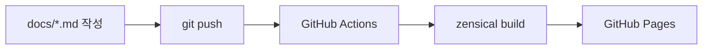

# 개발 블로그를 시작합니다

MkDocs Material과 GitHub Pages로 프로젝트 노트를 기록할 블로그를 만들었습니다.

<!-- more -->

## 목표

- [x] `Unity-lin.github.io`에 블로그 배포
- [x] `main`에 push하면 GitHub Actions가 자동으로 빌드·배포
- [ ] 진행한 프로젝트마다 노트 1편 이상 작성

## 구성

| 항목 | 선택 |
|---|---|
| 정적 사이트 생성기 | Zensical (MkDocs Material 호환) |
| 호스팅 | GitHub Pages |
| 배포 | GitHub Actions |

## 새 글 쓰는 법

1. `docs/blog/posts/YYYY-MM-DD-slug/index.md` 생성
2. 상단에 `date`, `slug`, `categories` 작성
3. 로컬 미리보기: `zensical serve --open`
4. `git add docs && git commit -m "post: ..." && git push`

!!! tip "기록 팁"
    결과만이 아니라 **왜** 그렇게 했는지, 어떤 에러를 만났는지 함께 적어두면 나중에 가장 도움이 됩니다.
